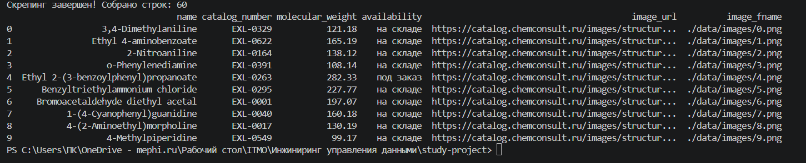
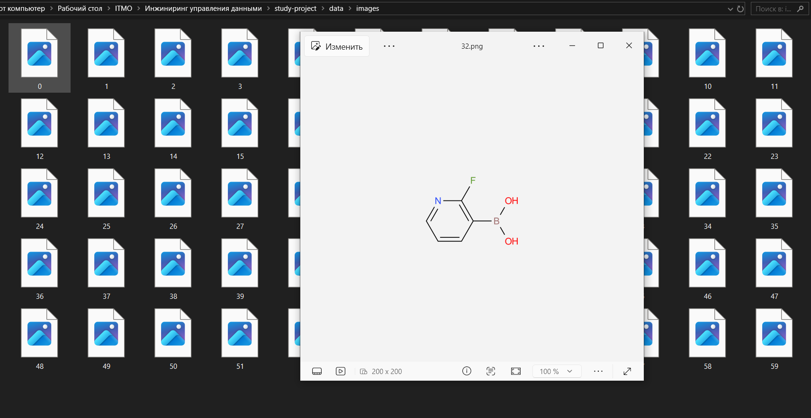

# Домашнее задание №4 (Скрейпинг сайта)

**Что парсилось:** Первая страница каталога химических реактивов компании ЛабЭксперт (названия соединений, их номера в каталоге, молекулярный вес, статус наличия на складе, а также ссылки на изображения структурных формул). 
**Откуда:** [https://labexperts.ru](https://labexperts.ru)

Скрипт осуществляет скрейпинг первой страницы сайта, а также скачивает в папку data/images/ изображения структурных формул реактивов.

## 📊 Результаты работы скрипта

### Первые 10 строк собранного датасета (вывод в терминал):

### Скриншот локальной директории со скачанными структурами:

